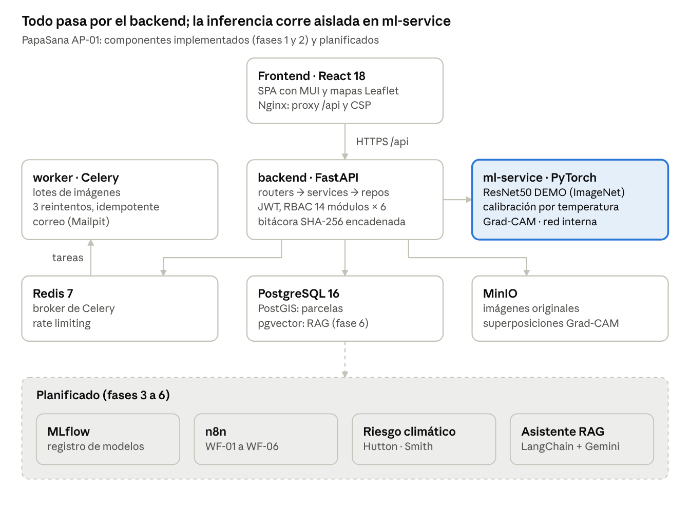

> **Aviso sobre los datos.** La metodología, la arquitectura y el sistema descritos corresponden a lo implementado en el proyecto PapaSana AP-01 (fases 0 a 2). Todas las cifras de la sección 5 y las marcadas con **[DEMO]** son **datos de ejemplo inventados** para mostrar el formato del artículo. No son resultados experimentales y deben reemplazarse cuando se ejecute la Fase 4 (entrenamiento y validación).

# Resumen

El tizón tardío, causado por *Phytophthora infestans*, es la enfermedad foliar más destructiva de la papa. Los clasificadores de imágenes publicados superan el 95 % de exactitud en fotografías de laboratorio, pero su rendimiento cae en campo, donde cambian la iluminación, el fondo, la variedad y el estadio fenológico. Este trabajo presenta un marco que aborda esa brecha en cuatro frentes. Primero, define un esquema de etiquetas por síntoma (sano, síntomas compatibles con tizón tardío, otra enfermedad foliar) que evita confundir el tizón temprano por *Alternaria solani* con la fase inicial del tizón tardío; la confirmación etiológica queda reservada a un especialista. Segundo, aplica un protocolo sin fuga de información: deduplicación por SHA-256 y hash perceptual dentro y entre datasets, validación cruzada agrupada de cinco particiones y validación externa de laboratorio a campo. Tercero, compara tres arquitecturas individuales (ResNet50, EfficientNet-B3, ConvNeXt-Tiny) y dos híbridas (CNN-ViT y EfficientNet-Atención-BiLSTM) con el mismo presupuesto de optimización en Optuna, calibración por temperatura y pruebas de Friedman, Wilcoxon-Holm, McNemar y DeLong. Cuarto, integra el modelo en un sistema de apoyo a la decisión con explicaciones Grad-CAM, revisión experta con registro inmutable, georreferenciación con PostGIS y fusión tardía con un índice de riesgo climático (criterios de Hutton y Smith). Con **datos de ejemplo [DEMO]**, el mejor modelo híbrido obtiene un F1-macro de 0,981 en validación interna y de 0,742 en validación externa, una caída de 23,9 puntos que cuantifica la brecha laboratorio-campo.

**Palabras clave:** *Phytophthora infestans*; aprendizaje profundo; inteligencia artificial explicable; Grad-CAM; fuga de información; validación externa; agricultura de precisión; sistema de apoyo a la decisión.

# Highlights

- Esquema de etiquetas por síntoma que separa el tizón tardío del tizón temprano (*Alternaria solani*).
- Deduplicación entre datasets y validación agrupada para evitar resultados inflados.
- Cinco arquitecturas comparadas con el mismo presupuesto de Optuna y pruebas estadísticas por partición.
- Sistema desplegable con Grad-CAM, revisión experta trazable y alertas de riesgo climático.
- Se cuantifica la caída de rendimiento entre imágenes de laboratorio y de campo.

# 1. Introducción

El tizón tardío de la papa (*Solanum tuberosum* L.), causado por el oomiceto *Phytophthora infestans*, puede destruir un cultivo en pocos días cuando la humedad y la temperatura le son favorables [1, 2]. Su control depende de detectar los primeros síntomas y de aplicar fungicidas a tiempo. En la sierra del Perú, donde la papa es base de la economía campesina, esa detección descansa en la inspección visual de técnicos y agricultores, que es lenta y depende de la experiencia de cada observador.

El aprendizaje profundo ha logrado exactitudes superiores al 99 % en la clasificación de enfermedades foliares sobre PlantVillage [3, 4]. Sin embargo, esas imágenes se tomaron con hojas desprendidas, sobre fondo uniforme y con luz controlada. Cuando los mismos modelos se evalúan con fotos de campo, la exactitud cae de forma marcada [4, 5, 6]. Parte de esa diferencia se explica por aprendizaje de atajos: la red aprende el fondo o la iluminación en lugar de la lesión [7].

El problema tiene tres causas metodológicas que la literatura suele pasar por alto:

1. **Etiquetas mal definidas.** En PlantVillage y en muchos datasets derivados, la clase *Early blight* es el tizón temprano por *Alternaria solani*, otra enfermedad. No es la fase inicial del tizón tardío. Ningún dataset público confirma la etiología de sus imágenes, así que un modelo no puede afirmar «tizón tardío confirmado».
2. **Fuga de información.** Las divisiones aleatorias 80/20 colocan fotos casi idénticas de la misma hoja en entrenamiento y prueba. Además, varios datasets de Kaggle copian PlantVillage, lo que contamina la llamada validación externa [8].
3. **Evaluación aislada del uso.** Se informan métricas, pero no cómo se integra el modelo en un flujo de trabajo con revisión humana, trazabilidad y contexto climático.

Este artículo responde a las tres causas. Sus contribuciones son:

- **C1.** Un esquema de etiquetas por síntoma con tres capas: lo que predice el modelo, lo que ve el usuario y lo que confirma el especialista.
- **C2.** Un protocolo de evaluación sin fuga de información, con deduplicación entre datasets, validación cruzada agrupada y validación externa de laboratorio a campo.
- **C3.** Una comparación de cinco arquitecturas con presupuesto de optimización igual, calibración y pruebas estadísticas sobre bloques de evaluación independientes.
- **C4.** Un sistema de apoyo a la decisión de código abierto (PapaSana AP-01) que integra Grad-CAM, revisión experta con bitácora inmutable, parcelas georreferenciadas y fusión tardía con riesgo climático.

La sección 2 revisa los trabajos relacionados. La sección 3 describe los datos y el protocolo. La sección 4 presenta la arquitectura del sistema. La sección 5 muestra los resultados con datos de ejemplo. Las secciones 6 y 7 discuten las limitaciones y concluyen.

# 2. Trabajos relacionados

**Clasificación de enfermedades foliares.** Mohanty et al. [4] entrenaron AlexNet y GoogLeNet sobre PlantVillage y alcanzaron un 99,35 % de exactitud, pero esa cifra bajó a cerca del 31 % con imágenes de otras fuentes. Ferentinos [5] obtuvo resultados similares: los modelos entrenados en laboratorio rindieron mucho menos en campo. Barbedo [6] enumeró los factores que explican esa caída: fondo, iluminación, síntomas simultáneos y tamaño de los datasets. PlantDoc [9] reunió imágenes de internet en condiciones no controladas y confirmó que las redes preentrenadas en PlantVillage generalizan mal.

**Arquitecturas.** Las redes residuales [10], EfficientNet [11] y ConvNeXt [12] son las bases convolucionales más usadas. Los Vision Transformers [13] captan relaciones globales, y los híbridos CNN-Transformer combinan texturas locales de la lesión con el contexto de la hoja. Las variantes con atención y BiLSTM tratan el mapa de características como una secuencia espacial.

**Explicabilidad e incertidumbre.** Grad-CAM [14] y SHAP [15] se usan para mostrar dónde mira el modelo. Sin embargo, un mapa de saliencia no prueba que la explicación sea fiel [16]: hay que medir su estabilidad y su coincidencia con la lesión. Las redes modernas suelen estar mal calibradas; el escalado por temperatura corrige ese sesgo con un solo parámetro [17].

**Rigor de evaluación.** Kapoor y Narayanan [8] documentaron la fuga de información como causa principal de resultados irreproducibles en ciencia basada en aprendizaje automático. Demšar [18] recomendó las pruebas de Friedman y post hoc para comparar varios clasificadores. Chicco y Jurman [19] mostraron que el MCC es más informativo que la exactitud y el F1 con clases desbalanceadas.

**Pronóstico climático del tizón tardío.** Los criterios de Smith [20] y su revisión, los criterios de Hutton [21], definen periodos de alto riesgo a partir de la temperatura mínima y las horas con humedad relativa ≥ 90 %. Fueron calibrados en el Reino Unido y no están validados para los Andes.

**Brecha.** Ningún trabajo revisado combina: etiquetas por síntoma con diferencial explícito, deduplicación entre datasets, validación externa de laboratorio a campo con pruebas estadísticas por partición, y un sistema desplegable con revisión experta trazable y riesgo climático. La Tabla 1 resume esta comparación.

**Tabla 1.** Comparación con trabajos representativos (✓ = lo incluye).

| Trabajo | Etiquetas por síntoma | Dedup. entre datasets | Validación externa | Pruebas estadísticas | XAI evaluada | Sistema desplegado | Riesgo climático |
|---|---|---|---|---|---|---|---|
| Mohanty et al. 2016 [4] | — | — | parcial | — | — | — | — |
| Ferentinos 2018 [5] | — | — | ✓ | — | — | — | — |
| Singh et al. 2020 (PlantDoc) [9] | — | — | ✓ | — | — | — | — |
| Este trabajo | ✓ | ✓ | ✓ | ✓ | ✓ | ✓ | ✓ |

# 3. Materiales y métodos

El estudio es experimental computacional con imágenes públicas, complementado con imágenes de campo capturadas por el sistema y validadas por un especialista.

## 3.1 Esquema de etiquetas

El esquema tiene tres capas (Tabla 2). El modelo predice síntomas, no patógenos. La categoría «confirmado» solo la asigna un especialista agrónomo con evidencia: esporulación observada, cámara húmeda o laboratorio. El tizón temprano (*A. solani*) se trata como diagnóstico diferencial dentro de la clase «otra enfermedad foliar».

**Tabla 2.** Esquema de etiquetas en tres capas.

| Capa | Clases | Quién la asigna |
|---|---|---|
| Modelo | `sano` · `sintomas_compatibles_tizon_tardio` · `otra_enfermedad_foliar` | Red neuronal |
| Usuario | Sano · Sospechoso · Tizón tardío: síntomas compatibles | Regla de decisión (umbral τ) |
| Validación | Confirmado · Corregido · No determinable | Especialista agrónomo |

La regla de decisión marca un caso como Sospechoso, y lo envía a revisión, si la confianza calibrada es menor que τ (0,70 por defecto, configurable) o si la clase predicha es otra enfermedad foliar. Los casos compatibles con tizón tardío también pasan a revisión. Solo los sanos con confianza suficiente se cierran automáticamente.

## 3.2 Datos

**Tabla 3.** Fuentes de datos. Los recuentos marcados **[DEMO]** son de ejemplo; los demás deben verificarse en la fuente antes del envío. Las licencias se registran antes de cada descarga.

| Dataset | Condición | Uso | Sano | Tizón tardío | Otra enfermedad |
|---|---|---|---|---|---|
| PlantVillage, papa [3] | Laboratorio, fondo uniforme | Entrenamiento y validación interna | 152 | 1000 | 1000 |
| PlantDoc, papa [9] | Internet, no controlada | Validación externa 1 | 58 [DEMO] | 105 [DEMO] | 116 [DEMO] |
| Dataset de campo (Mendeley Data) | Campo | Validación externa 2 | 420 [DEMO] | 380 [DEMO] | 310 [DEMO] |
| PapaSana, valle del Mantaro | Campo, Perú, validado por experto | Validación prospectiva | 96 [DEMO] | 61 [DEMO] | 43 [DEMO] |

El dataset Kaggle *potato-leaf* se descartó porque es un subconjunto de PlantVillage y su licencia figura como desconocida. Las fotos capturadas con la aplicación conservan su EXIF/GPS, se asocian a una parcela dibujada en PostGIS y se usan solo con consentimiento, conforme a la Ley N.° 29733 de protección de datos personales.

## 3.3 Preprocesamiento y control de fuga de información

1. **Deduplicación exacta** por SHA-256 dentro de cada dataset y entre datasets.
2. **Casi duplicados** por hash perceptual de 64 bits (dHash): dos imágenes con distancia de Hamming ≤ 6 se agrupan. Esta agrupación se cruza entre PlantVillage y los datasets externos para retirar copias.
3. **Grupos sin identificador de planta.** PlantVillage no publica IDs de planta. Como aproximación, se agrupan los clústeres de hash perceptual y de embeddings, y se usa `StratifiedGroupKFold` con k = 5. Donde existen IDs de planta, parcela o procedencia, se usan esos.
4. **Redimensionamiento** a 224 × 224 píxeles (300 × 300 para EfficientNet-B3) y normalización con la media y la desviación de ImageNet.
5. **Aumento de datos** después de dividir y solo en entrenamiento: volteos, rotaciones, recorte aleatorio, cambios de color y desenfoque.
6. **Balanceo** con muestreo ponderado por la inversa de la frecuencia de clase.

## 3.4 Modelos

Todos los modelos se implementan en PyTorch con la librería `timm`, preentrenados en ImageNet:

- **M1 ResNet50** [10], línea base.
- **M2 EfficientNet-B3** [11].
- **M3 ConvNeXt-Tiny** [12].
- **H1 CNN-ViT:** los tokens del último bloque convolucional de una ResNet50 pasan por un codificador Transformer de 4 capas y 8 cabezas, con un token de clase.
- **H2 EfficientNet-Atención-BiLSTM:** el mapa de características de EfficientNet-B3 se lee como una secuencia de filas espaciales; una BiLSTM con atención aditiva resume la secuencia. Con datos públicos la secuencia es espacial; la variante temporal, con fotos de la misma parcela en el tiempo, queda como trabajo futuro.

## 3.5 Optimización de hiperparámetros

Optuna [22] con muestreador TPE y `MedianPruner`. Los cinco modelos reciben el mismo presupuesto: 60 intentos y 30 épocas máximas por intento [DEMO], además de las horas de GPU registradas. El espacio de búsqueda incluye tasa de aprendizaje (10⁻⁵ a 10⁻³), tamaño de lote (16, 32), dropout (0 a 0,5), weight decay (10⁻⁶ a 10⁻²) y, en H1, el número de cabezas. La búsqueda usa solo las particiones de entrenamiento y validación internas; los conjuntos externos no intervienen. Los entrenamientos cortos se ejecutan en una RTX 3050 de 6 GB con precisión mixta; las búsquedas completas, en Google Colab. Todo se registra en MLflow.

## 3.6 Calibración

Se aplica escalado por temperatura [17] sobre la validación interna. Dados los logits $z$, la probabilidad calibrada de la clase $k$ es:

$$\hat{p}_k = \frac{\exp(z_k / T)}{\sum_{j=1}^{K} \exp(z_j / T)}, \qquad T^{*} = \arg\min_{T>0} \; -\sum_{i} \log \hat{p}_{y_i}(T)$$

La calidad de la calibración se mide con el error de calibración esperado (ECE) sobre $M = 15$ intervalos de confianza:

$$\mathrm{ECE} = \sum_{m=1}^{M} \frac{|B_m|}{n} \left| \mathrm{acc}(B_m) - \mathrm{conf}(B_m) \right|$$

## 3.7 Explicabilidad

Grad-CAM [14] se calcula en línea sobre la última capa convolucional. Para la clase $c$ y los mapas de activación $A^k$ de esa capa:

$$\alpha_k^{c} = \frac{1}{Z} \sum_{i}\sum_{j} \frac{\partial y^{c}}{\partial A_{ij}^{k}}, \qquad L^{c}_{\text{Grad-CAM}} = \mathrm{ReLU}\left( \sum_{k} \alpha_k^{c} A^{k} \right)$$

SHAP [15] y los mapas de atención de H1 se calculan fuera de línea por su costo. Las explicaciones se evalúan con dos métricas: **relevancia**, la fracción de la energía del mapa que cae dentro de la lesión anotada en una muestra de 200 imágenes [DEMO]; y **estabilidad**, la correlación de rangos de Spearman entre el mapa original y el obtenido tras perturbaciones leves de brillo y ruido.

## 3.8 Métricas y pruebas estadísticas

Se informan exactitud, sensibilidad, especificidad, F1 (por clase y macro), MCC, AUC-ROC y AUC-PR, con intervalos de confianza al 95 % por bootstrap (2000 remuestreos). Para $K$ clases, el MCC se calcula a partir de la matriz de confusión:

$$\mathrm{MCC} = \frac{c \cdot s - \sum_{k} p_k t_k}{\sqrt{\left(s^{2} - \sum_{k} p_k^{2}\right)\left(s^{2} - \sum_{k} t_k^{2}\right)}}$$

donde $c$ es el número de aciertos, $s$ el total de muestras, $p_k$ las predicciones de la clase $k$ y $t_k$ sus casos reales.

La prueba de Friedman compara los cinco modelos usando como bloques las 5 particiones internas más los 2 escenarios externos (7 bloques), nunca cinco valores agregados de una sola partición [18]. Las comparaciones por pares usan Wilcoxon con corrección de Holm. Sobre el mismo conjunto externo se aplican McNemar a los errores y DeLong [23] a las curvas ROC (uno contra el resto). El nivel de significación es α = 0,05.

# 4. Sistema propuesto: PapaSana AP-01

El modelo se integra en un sistema web de apoyo a la decisión, desplegado con Docker Compose. Las fases 1 y 2 están implementadas: autenticación, permisos, bitácora, parcelas, captura, diagnóstico con el modelo DEMO y validación experta. Las fases 3 a 6 (reportes, MLOps, riesgo climático y asistente) están diseñadas.

{width=100%}

El navegador solo habla con el backend. El servicio de inferencia no publica puertos, no tiene estado y no conoce las credenciales de la base de datos ni del almacenamiento.

## 4.1 Flujo de un diagnóstico

1. El técnico de campo sube una foto o un lote de hasta 20 fotos asociadas a una parcela.
2. El backend valida el tipo y el tamaño (máximo 15 MB), extrae el EXIF/GPS y comprueba con PostGIS si el punto cae dentro del polígono de la parcela.
3. Calcula SHA-256 y dHash. Un duplicado exacto se rechaza; un casi duplicado (Hamming ≤ 6) se acepta y se marca para excluirlo del reentrenamiento.
4. `ml-service` devuelve las probabilidades calibradas, la clase, la confianza y la superposición Grad-CAM.
5. El backend aplica la regla de decisión de la sección 3.1 y guarda el diagnóstico con la versión del modelo y el umbral usado.
6. Los casos sospechosos o compatibles pasan a la bandeja del especialista, ordenada por prioridad. «Confirmado» exige evidencia, y «otra enfermedad» exige el diferencial del catálogo.

Los lotes se procesan en segundo plano con Celery, con tres reintentos e idempotencia.

## 4.2 Trazabilidad y seguridad

- **Bitácora inmutable:** cada acción queda con valores antes y después, IP y duración en el módulo. Cada registro guarda SHA-256(hash anterior ‖ registro), calculado por un trigger. `UPDATE`, `DELETE` y `TRUNCATE` están bloqueados. Un endpoint recorre la cadena e informa del primer registro alterado.
- **Sin borrado de datos científicos:** diagnósticos, imágenes y revisiones no se pueden borrar; anular un diagnóstico exige un motivo.
- **Control de acceso:** RBAC de 14 módulos × 6 acciones con alcance por fila. El técnico ve sus parcelas y el agrónomo las de su región.
- **Datos personales:** contraseñas con Argon2id, acceso a imágenes solo a través del backend y fotos de perfil sin metadatos EXIF.
- **Aviso visible:** mientras el modelo sea DEMO, todas las pantallas y respuestas muestran la franja «DEMO / no validado».

## 4.3 Fusión tardía con el riesgo climático (diseñada)

Un flujo de n8n consultará cada 3 horas la temperatura y la humedad horarias de Open-Meteo en el centroide de cada parcela. El riesgo es alto cuando se cumplen los criterios de Hutton: dos días seguidos con temperatura mínima ≥ 10 °C y al menos 6 horas diarias con humedad relativa ≥ 90 %. La alerta combinada se emite si el riesgo climático es alto y hay al menos un diagnóstico compatible en la parcela, o en un radio configurable, en los últimos N días.

# 5. Resultados (DATOS DE EJEMPLO / DEMO)

> **Todas las cifras de esta sección son inventadas** para ilustrar el formato. Se reemplazarán con los resultados de la Fase 4. Solo dos datos son reales: el sistema de las fases 1 y 2 está implementado, y sus 17 pruebas de frontend (Vitest) pasan.

Con datos de ejemplo, H1 (CNN-ViT) es el mejor modelo en campo: F1-macro de 0,742 (IC 95 % por bootstrap: 0,716 a 0,767), frente a 0,981 en validación interna.

## 5.1 Validación interna frente a validación externa

![**Figura 2.** F1-macro en validación interna (media de 5 particiones) y en validación externa de campo, por modelo. Datos de ejemplo [DEMO].](figuras/figura2_f1_interna_vs_campo.png){width=100%}

La caída es mayor en ResNet50 y menor en los modelos con componentes globales (H1, H2, ConvNeXt). La Tabla 4 detalla las demás métricas en el conjunto de campo (n = 1110).

**Tabla 4.** Métricas externas [DEMO]. TT = tizón tardío (uno contra el resto). ECE antes → después del escalado por temperatura.

| Modelo | F1-macro PlantDoc | Exactitud | Sensibilidad TT | Especificidad TT | MCC | AUC-ROC TT | AUC-PR TT | ECE |
|---|---|---|---|---|---|---|---|---|
| H1 CNN-ViT | 0,728 | 0,752 | 0,803 | 0,871 | 0,625 | 0,903 | 0,826 | 0,089 → 0,029 |
| H2 EfficientNet-Atención-BiLSTM | 0,715 | 0,741 | 0,791 | 0,864 | 0,602 | 0,896 | 0,814 | 0,093 → 0,031 |
| M3 ConvNeXt-Tiny | 0,703 | 0,733 | 0,779 | 0,856 | 0,588 | 0,887 | 0,801 | 0,097 → 0,033 |
| M2 EfficientNet-B3 | 0,657 | 0,701 | 0,744 | 0,838 | 0,541 | 0,869 | 0,768 | 0,104 → 0,037 |
| M1 ResNet50 | 0,611 | 0,662 | 0,701 | 0,812 | 0,489 | 0,842 | 0,731 | 0,118 → 0,041 |

**Tabla 5.** Matriz de confusión de H1 en el conjunto de campo [DEMO]. Filas: clase real; columnas: clase predicha.

| Real \\ Predicha | Sano | Tizón tardío | Otra enfermedad | Total |
|---|---|---|---|---|
| Sano | **340** | 30 | 50 | 420 |
| Tizón tardío | 22 | **305** | 53 | 380 |
| Otra enfermedad | 56 | 64 | **190** | 310 |

## 5.2 Pruebas estadísticas

La prueba de Friedman sobre 7 bloques (5 particiones + 2 escenarios externos) rechaza la igualdad de los cinco modelos: χ²(4) = 24,11; p < 0,001 [DEMO]. Ninguna comparación de Wilcoxon sobrevive a la corrección de Holm, porque con 7 bloques el menor p posible es 0,016. Sobre el conjunto de campo, McNemar separa a H1 de M1 (χ² = 38,2; p < 0,001), pero no de M3 (p = 0,08) ni de H2 (p = 0,41) [DEMO]. DeLong [23] confirma la diferencia de AUC-ROC entre H1 y M1 (p < 0,001), pero no entre H1 y M3 (p = 0,11) [DEMO].

## 5.3 Explicabilidad

**Tabla 6.** Evaluación de Grad-CAM en 200 imágenes con lesión anotada [DEMO].

| Modelo | Energía dentro de la lesión | Energía fuera de la hoja | Estabilidad (Spearman) |
|---|---|---|---|
| H1 CNN-ViT | 0,64 | 0,14 | 0,81 |
| H2 EfficientNet-Atención-BiLSTM | 0,61 | 0,17 | 0,80 |
| M3 ConvNeXt-Tiny | 0,59 | 0,19 | 0,79 |
| M2 EfficientNet-B3 | 0,55 | 0,24 | 0,76 |
| M1 ResNet50 | 0,48 | 0,31 | 0,72 |

## 5.4 Desempeño operativo del sistema

**Tabla 7.** Indicadores del prototipo [DEMO], medidos en CPU con 2 hilos.

| Indicador | Valor [DEMO] |
|---|---|
| Inferencia + Grad-CAM, mediana (p95) | 420 ms (610 ms) |
| Respuesta de extremo a extremo de una foto, mediana | 1,3 s |
| Lote de 20 fotos en segundo plano | 31 s |
| Casos enviados a revisión con τ = 0,70 | 38 % |
| Error en casos cerrados automáticamente como sanos | 4,1 % |
| Concordancia modelo-especialista (κ de Cohen, 200 casos) | 0,61 |

# 6. Discusión

> Esta discusión interpreta los **datos de ejemplo [DEMO]** de la sección 5 para mostrar la estructura argumental. Debe reescribirse con los resultados reales.

**La brecha laboratorio-campo domina el resultado.** Todos los modelos superan 0,96 de F1-macro en validación interna, pero pierden entre 24 y 31 puntos en campo. La diferencia entre arquitecturas (como máximo 9,4 puntos en campo) es menor que la caída que comparten. Esto coincide con lo informado por Mohanty et al. [4] y Ferentinos [5] e indica que la exactitud en PlantVillage no sirve para elegir un modelo de campo.

**Los híbridos generalizan algo mejor, pero la evidencia es limitada.** H1 (CNN-ViT) obtiene el mejor F1-macro y MCC externos. Su ventaja sobre ResNet50 es clara en McNemar y DeLong. Frente a ConvNeXt-Tiny y H2, en cambio, las diferencias no son significativas. Con 7 bloques, el valor p exacto más pequeño de Wilcoxon es 0,016, y la corrección de Holm sobre 10 comparaciones no puede alcanzarlo. Para separar modelos cercanos harán falta más escenarios externos o una unidad de análisis distinta.

**La confusión principal es con otras enfermedades foliares.** En la matriz de confusión de H1, el 21 % de las hojas con otra enfermedad se predicen como tizón tardío. Las lesiones necróticas de *A. solani* y el estrés abiótico se parecen al tizón tardío en fotos de campo. Este resultado justifica el esquema de etiquetas: un sistema que mezclara «tizón temprano» con «fase inicial del tizón tardío» ocultaría precisamente este error.

**Las explicaciones revelan atajos.** En ResNet50, una parte importante de la energía de Grad-CAM cae fuera de la hoja. Esto sugiere que el modelo aprendió el fondo uniforme de PlantVillage [7]. H1 concentra más energía en la lesión y produce mapas más estables. Los mapas de saliencia, sin embargo, no prueban causalidad [16]; por eso se miden contra lesiones anotadas.

**La revisión experta es parte del diseño, no un parche.** Con τ = 0,70, una fracción alta de los casos de campo pasa a revisión. Es el costo de no cerrar automáticamente casos dudosos. La calibración por temperatura hace que ese umbral tenga sentido: sin calibrar, la confianza sobrestima la exactitud real.

## 6.1 Limitaciones

- **Sin confirmación etiológica.** Las etiquetas públicas son de síntoma. El modelo no diagnostica *P. infestans*; detecta síntomas compatibles.
- **Grupos aproximados.** PlantVillage no publica IDs de planta. La agrupación por hash perceptual y embeddings reduce la fuga, pero no la elimina.
- **Multimodalidad a nivel de sistema.** La fusión con el clima es tardía, en la alerta. No se entrenó un modelo imagen-clima porque los datasets públicos no traen datos meteorológicos.
- **Reglas de riesgo no validadas localmente.** Los criterios de Hutton y Smith se calibraron en el Reino Unido. En la sierra peruana su uso es experimental y sus parámetros son configurables.
- **Muestra prospectiva pequeña.** Las imágenes propias provienen de pocas parcelas del valle del Mantaro y no representan todas las variedades ni altitudes.

## 6.2 Trabajo futuro

- Variante temporal de H2 con fotos de la misma parcela en el tiempo.
- Fusión imagen-clima dentro del modelo con datos propios georreferenciados y fechados.
- Calibración local de las reglas de riesgo con registros de brotes en Junín y Cusco.
- Reentrenamiento con los casos validados por experto y monitoreo de deriva.

# 7. Conclusiones

Este trabajo propone un marco para detectar síntomas de tizón tardío en condiciones de campo que trata la evaluación con el mismo cuidado que el modelo. El esquema de etiquetas por síntoma evita una confusión frecuente con *A. solani* y deja la confirmación en manos de un especialista. El protocolo de deduplicación entre datasets, validación agrupada y validación externa permite medir la brecha laboratorio-campo en lugar de ocultarla. El sistema PapaSana AP-01 muestra cómo llevar el modelo a un flujo real con explicaciones, revisión trazable y contexto climático. Con **datos de ejemplo [DEMO]**, la brecha alcanza entre 24 y 31 puntos de F1-macro. Los resultados definitivos se obtendrán con los entrenamientos de la Fase 4.

# Declaraciones

- **Disponibilidad de datos:** los datasets públicos están disponibles en sus fuentes originales. Las imágenes de campo propias contienen datos personales (ubicación GPS, productores) y se compartirán de forma anonimizada previa solicitud.
- **Disponibilidad de código:** el código del sistema y de los experimentos se publicará en un repositorio público con su notebook de Google Colab. *[Pendiente: enlace y DOI de Zenodo.]*
- **Ética:** las imágenes de campo se capturan con consentimiento informado, conforme a la Ley N.° 29733. El sistema es una herramienta de apoyo y no reemplaza el diagnóstico de un profesional agrónomo.
- **Contribuciones (CRediT):** *[Pendiente: autores y roles.]*
- **Conflicto de intereses:** los autores declaran no tener conflictos de intereses.
- **Financiamiento:** *[Pendiente.]*

# Referencias

> Lista compilada de memoria, sin consultar las fuentes. Antes del envío hay que verificar cada referencia y añadir su DOI. La [21] es la menos segura en paginación y fuente.

1. Fry, W. (2008). *Phytophthora infestans*: the plant (and R gene) destroyer. *Molecular Plant Pathology*, 9(3), 385–402.
2. Haverkort, A. J., et al. (2008). Societal costs of late blight in potato and prospects of durable resistance through cisgenic modification. *Potato Research*, 51, 47–57.
3. Hughes, D. P., & Salathé, M. (2015). An open access repository of images on plant health to enable the development of mobile disease diagnostics. *arXiv:1511.08060*.
4. Mohanty, S. P., Hughes, D. P., & Salathé, M. (2016). Using deep learning for image-based plant disease detection. *Frontiers in Plant Science*, 7, 1419.
5. Ferentinos, K. P. (2018). Deep learning models for plant disease detection and diagnosis. *Computers and Electronics in Agriculture*, 145, 311–318.
6. Barbedo, J. G. A. (2018). Factors influencing the use of deep learning for plant disease recognition. *Biosystems Engineering*, 172, 84–91.
7. Geirhos, R., et al. (2020). Shortcut learning in deep neural networks. *Nature Machine Intelligence*, 2, 665–673.
8. Kapoor, S., & Narayanan, A. (2023). Leakage and the reproducibility crisis in machine-learning-based science. *Patterns*, 4(9), 100804.
9. Singh, D., et al. (2020). PlantDoc: A dataset for visual plant disease detection. *Proc. 7th ACM IKDD CoDS and 25th COMAD*, 249–253.
10. He, K., Zhang, X., Ren, S., & Sun, J. (2016). Deep residual learning for image recognition. *Proc. IEEE CVPR*, 770–778.
11. Tan, M., & Le, Q. V. (2019). EfficientNet: Rethinking model scaling for convolutional neural networks. *Proc. ICML*, 6105–6114.
12. Liu, Z., et al. (2022). A ConvNet for the 2020s. *Proc. IEEE/CVF CVPR*, 11976–11986.
13. Dosovitskiy, A., et al. (2021). An image is worth 16x16 words: Transformers for image recognition at scale. *Proc. ICLR*.
14. Selvaraju, R. R., et al. (2017). Grad-CAM: Visual explanations from deep networks via gradient-based localization. *Proc. IEEE ICCV*, 618–626.
15. Lundberg, S. M., & Lee, S.-I. (2017). A unified approach to interpreting model predictions. *Advances in NeurIPS*, 30.
16. Adebayo, J., et al. (2018). Sanity checks for saliency maps. *Advances in NeurIPS*, 31.
17. Guo, C., Pleiss, G., Sun, Y., & Weinberger, K. Q. (2017). On calibration of modern neural networks. *Proc. ICML*, 1321–1330.
18. Demšar, J. (2006). Statistical comparisons of classifiers over multiple data sets. *Journal of Machine Learning Research*, 7, 1–30.
19. Chicco, D., & Jurman, G. (2020). The advantages of the Matthews correlation coefficient (MCC) over F1 score and accuracy in binary classification evaluation. *BMC Genomics*, 21, 6.
20. Smith, L. P. (1956). Potato blight forecasting by 90 per cent humidity criteria. *Plant Pathology*, 5(3), 83–87.
21. Dancey, S., Skelsey, P., & Cooke, D. E. L. (2017). The Hutton Criteria: a classification tool for identifying high risk periods for potato late blight disease development in Great Britain. *Proc. 16th EuroBlight Workshop*, PAGV Special Report 18.
22. Akiba, T., Sano, S., Yanase, T., Ohta, T., & Koyama, M. (2019). Optuna: A next-generation hyperparameter optimization framework. *Proc. ACM SIGKDD*, 2623–2631.
23. DeLong, E. R., DeLong, D. M., & Clarke-Pearson, D. L. (1988). Comparing the areas under two or more correlated receiver operating characteristic curves. *Biometrics*, 44(3), 837–845.
