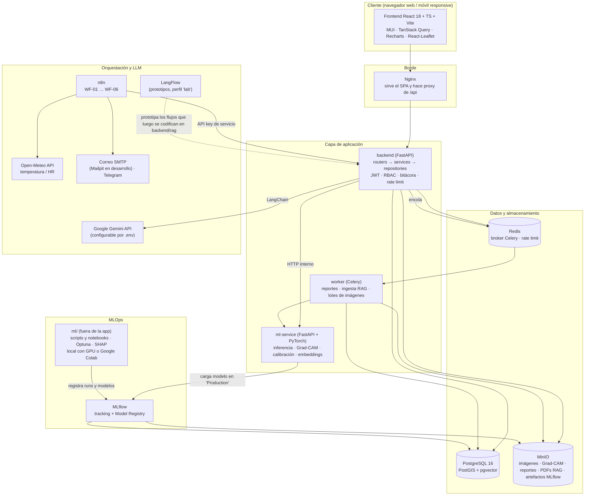
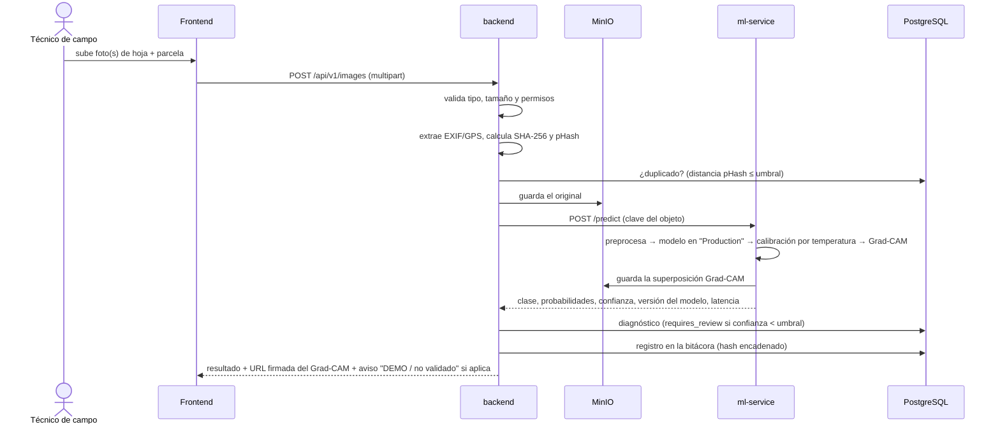
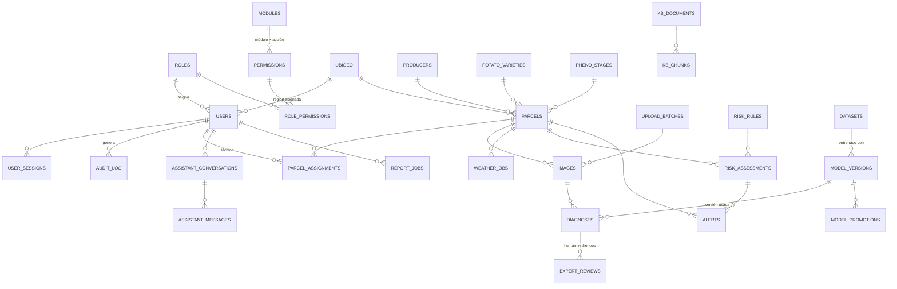

# Fase 0 — Planificación del sistema AP-01

**Proyecto (título de trabajo, ver D-07):** *Explainable Deep Learning for Symptom-Based Detection of Potato Late Blight Under Field Conditions, Integrated with Climate-Based Risk Alerts*
*Aprendizaje profundo explicable para la detección por síntomas del tizón tardío de la papa en condiciones de campo, integrado con alertas de riesgo climático*
**Título original (`contexto.md`):** *Multimodal Explainable Deep Learning for Early Detection of Potato Late Blight Under Real Field Conditions*
**Nombre de trabajo de la aplicación:** **PapaSana AP-01** (provisional)
**Fecha:** 2026-11-04 (revisado el mismo día)
**Estado:** D-03, D-05, D-06 y D-07 aprobadas; D-01 pendiente de confirmación. Todavía no se ha escrito código.

> Las decisiones tomadas y las que necesitan tu visto bueno están en [decisiones.md](decisiones.md).
> Las marcadas como **⚠ requiere aprobación** cambian el alcance o un criterio de aceptación.

---

## 1. Arquitectura

### 1.1 Vista de componentes



### 1.2 Servicios de `docker-compose`

| Servicio | Imagen / base | RAM aprox. | Perfil |
|---|---|---|---|
| `db` | `postgis/postgis:16` + extensión pgvector (Dockerfile propio) | 250 MB | por defecto |
| `redis` | `redis:7-alpine` | 20 MB | por defecto |
| `minio` + `minio-init` (crea buckets) | `minio/minio` | 150 MB | por defecto |
| `backend` | Python 3.12-slim | 250 MB | por defecto |
| `worker` | misma imagen que `backend` (incluye WeasyPrint) | 250 MB | por defecto |
| `ml-service` | Python 3.12 + PyTorch CPU (variante GPU opcional) | 900 MB–1,2 GB | por defecto |
| `mlflow` | Python 3.12 + mlflow | 300 MB | por defecto |
| `n8n` | `n8nio/n8n` | 300 MB | por defecto |
| `frontend` | build con Node → `nginx:alpine` | 20 MB | por defecto |
| `mailpit` | `axllent/mailpit` (captura correos de prueba) | 20 MB | por defecto |
| `langflow` | `langflowai/langflow` | 1–1,5 GB | `lab` |

Con el perfil por defecto se necesitan unos **3,5 GB** para Docker. Tu equipo tiene 7,6 GB en total, así que LangFlow va en un perfil aparte (`docker compose --profile lab up`). Ver la decisión **D-03 ⚠**.

### 1.3 Flujo principal: diagnóstico de una imagen



En los lotes grandes, el backend responde enseguida con un `batch_id`. El `worker` procesa las imágenes y el frontend consulta el avance.

### 1.4 Principios transversales

- **Capas del backend:** `routers` (HTTP y validación Pydantic) → `services` (reglas de negocio, permisos de alcance, bitácora) → `repositories` (SQLAlchemy 2.x). Los errores se manejan en un solo lugar con un formato de error único (`code`, `message`, `detail`, `trace_id`).
- **Permisos:** la dependencia `require_permission("modulo", "accion")` se aplica en cada endpoint. Además hay un **alcance por filas**: el técnico ve sus parcelas y diagnósticos, el agrónomo ve su región, y el investigador y el administrador lo ven todo.
- **Zona horaria:** se guarda todo como `timestamptz` en UTC y se muestra en `America/Lima`.
- **Datos personales:** las fotos con GPS, los productores y los usuarios son datos personales según la **Ley N.° 29733**. Por eso hay acceso mínimo por rol, URLs firmadas de corta duración en MinIO y ningún dato personal en los logs de aplicación.

---

## 2. Modelo de datos

### 2.1 Diagrama entidad-relación (entidades principales)



### 2.2 Tablas por dominio

**Seguridad**

| Tabla | Campos clave |
|---|---|
| `users` | `id` (uuid), `email` (único), `password_hash` (Argon2id), `full_name`, `institution`, `phone`, `region_code` → `ubigeo`, `role_id`, `photo_key`, `preferences` (jsonb), `is_active`, `failed_attempts`, `locked_until`, `last_login_at`, `password_changed_at` |
| `roles` | `id`, `code`, `name`, `description`, `is_system` (los roles semilla no se borran) |
| `modules` | `id`, `code` (`dashboard`, `parcelas`…), `name`, `route` |
| `permissions` | `id`, `module_id`, `action` (`ver`, `crear`, `editar`, `eliminar`, `exportar`, `aprobar`), único (`module_id`, `action`) |
| `role_permissions` | `role_id`, `permission_id` |
| `user_sessions` | `id`, `user_id`, `refresh_token_hash`, `ip`, `user_agent`, `created_at`, `last_seen_at`, `expires_at`, `revoked_at`, `revoke_reason` (`logout`, `inactividad`, `rotación`, `admin`) |
| `password_reset_tokens` | `id`, `user_id`, `token_hash`, `expires_at`, `used_at` |
| `service_accounts` | `id`, `name` (p. ej. `n8n`), `api_key_hash`, `role_id`, `is_active`, `last_used_at` |

**Bitácora** (append-only)

| Tabla | Campos clave |
|---|---|
| `audit_log` | `id` (bigserial), `occurred_at`, `user_id`, `role_code`, `session_id`, `event_type` (`login`, `logout`, `login_fallido`, `sesion_expirada`, `modulo_entrada`, `modulo_salida`, `accion`), `module_code`, `action`, `http_method`, `endpoint`, `entity_type`, `entity_id`, `before` (jsonb), `after` (jsonb), `ip` (inet), `user_agent`, `result` (`exito`/`fallo`), `error_detail`, `related_event_id` (la salida apunta a su entrada), `duration_ms`, `prev_hash`, `hash` |

- Un trigger `BEFORE UPDATE OR DELETE` y una regla contra `TRUNCATE` lanzan una excepción. El usuario de la aplicación en PostgreSQL solo tiene `INSERT` y `SELECT` sobre esta tabla.
- `hash = SHA-256(prev_hash ‖ JSON canónico del registro)`. Las inserciones se serializan con un `pg_advisory_xact_lock` para que la cadena no se bifurque.
- La entrada y la salida de un módulo son **dos eventos separados**. La salida guarda `related_event_id` y `duration_ms`, así que nunca se modifica el evento de entrada.
- El endpoint `GET /audit/verify` recorre la cadena e informa del primer registro alterado, si lo hay. WF-06 lo ejecuta todos los días.

**Catálogos**

| Tabla | Campos clave |
|---|---|
| `ubigeo` | `code` (6 dígitos, PK), `name`, `level` (`departamento`/`provincia`/`distrito`), `parent_code`, `geom` (MultiPolygon, opcional) |
| `potato_varieties` | `id`, `name`, `group` (nativa/mejorada), `late_blight_susceptibility` (opcional), `source` |
| `phenological_stages` | `id`, `code`, `name`, `order` |
| `differential_diseases` | `id`, `name`, `causal_agent`, `key_symptoms`, `distinguishing_features`, `source` (p. ej. tizón temprano por *Alternaria solani*) |

**Parcelas**

| Tabla | Campos clave |
|---|---|
| `producers` | `id`, `name`, `contact`, `region_code` (datos mínimos) |
| `parcels` | `id`, `code`, `name`, `producer_id`, `region_code`, `variety_id`, `sowing_date`, `phenological_stage_id`, `geom` (Polygon 4326), `centroid` (Point, generado), `area_ha` (generado), `is_active` |
| `parcel_assignments` | `parcel_id`, `user_id` (técnicos asignados) |

**Imágenes y diagnóstico**

| Tabla | Campos clave |
|---|---|
| `upload_batches` | `id`, `user_id`, `total`, `processed`, `status`, `created_at` |
| `images` | `id`, `object_key`, `sha256`, `phash` (bigint), `mime`, `size_bytes`, `width`, `height`, `exif` (jsonb, sin datos sensibles), `captured_at`, `location` (Point), `gps_source` (`exif`/`dispositivo`/`manual`/`ninguno`), `parcel_id`, `batch_id`, `uploaded_by`, `provenance` (`web`/`movil`/`n8n`), `duplicate_of_id` |
| `model_versions` | `id`, `architecture` (`resnet50`, `efficientnet_b3`, `convnext`, `cnn_vit`, `effnet_att_bilstm`), `mlflow_model_name`, `mlflow_version`, `stage` (`demo`/`staging`/`production`/`archived`), `is_demo`, `label_scheme` (`sintoma`/`patogeno`), `classes` (jsonb), `temperature` (calibración), `train_dataset_ids`, `metrics_summary` (jsonb, copiado de MLflow) |
| `diagnoses` | `id`, `image_id`, `model_version_id`, `predicted_class`, `probabilities` (jsonb), `confidence`, `gradcam_key`, `threshold_used`, `requires_review`, `status` (`automatico`/`pendiente_revision`/`validado`/`corregido`/`anulado`), `inference_ms`, `created_by`, `created_at` |
| `expert_reviews` | `id`, `diagnosis_id`, `reviewer_id`, `decision` (`confirma`/`corrige`/`no_determinable`), `final_label`, `notes`, `created_at` |
| `model_promotions` | `id`, `model_version_id`, `from_stage`, `to_stage`, `requested_by`, `approved_by`, `reason`, `created_at` |

**Clima y alertas**

| Tabla | Campos clave |
|---|---|
| `weather_observations` | `id`, `parcel_id`, `observed_at` (por hora), `temp_c`, `rh_pct`, `precip_mm`, `source`, `ingested_at`, único (`parcel_id`, `observed_at`, `source`) |
| `risk_rules` | `id`, `name` (`Hutton`, `Smith`, `personalizada`), `params` (jsonb: umbrales de T y HR, horas, días), `is_active`, `version` |
| `risk_assessments` | `id`, `parcel_id`, `date`, `rule_id`, `rule_version`, `risk_level` (`bajo`/`medio`/`alto`), `details` (jsonb) |
| `alerts` | `id`, `parcel_id`, `region_code`, `level`, `origin` (`diagnostico`/`clima`/`combinada`), `diagnosis_ids`, `risk_assessment_id`, `status` (`activa`/`enviada`/`cerrada`), `channels`, `dispatched_at`, `closed_by`, `closure_note` |

**Asistente IA (RAG)**

| Tabla | Campos clave |
|---|---|
| `kb_documents` | `id`, `title`, `institution` (FAO/SENASA/INIA/otra), `year`, `url`, `license_note`, `object_key`, `pages`, `status` (`procesando`/`indexado`/`error`), `uploaded_by` |
| `kb_chunks` | `id`, `document_id`, `page`, `chunk_index`, `content`, `embedding` (`vector(384)`, índice HNSW) |
| `assistant_conversations` | `id`, `user_id`, `context_type` (`diagnostico`/`parcela`/`libre`), `context_id`, `created_at` |
| `assistant_messages` | `id`, `conversation_id`, `role`, `content`, `citations` (jsonb: documento, página, fragmento), `evidence_found` (bool), `llm_provider`, `llm_model`, `latency_ms` |

**Reportes y módulos adicionales**

| Tabla | Campos clave |
|---|---|
| `report_jobs` | `id`, `report_type`, `format` (`pdf`/`docx`/`xlsx`), `params` (jsonb), `status`, `object_key`, `requested_by`, `origin` (`ui`/`n8n`), `model_version_ref`, `created_at`, `finished_at`, `error` |
| `notifications` | `id`, `user_id`, `type`, `title`, `body`, `link`, `read_at` |
| `system_settings` | `key`, `value` (jsonb), `updated_by`, `updated_at` (cada cambio queda en la bitácora) |
| `datasets` | `id`, `name`, `version`, `source_url`, `license`, `license_url`, `license_verified_by`, `license_verified_at`, `citation`, `label_scheme`, `n_images`, `has_group_ids`, `notes` |
| `drift_metrics` | `id`, `model_version_id`, `window_start`, `window_end`, `metric` (p. ej. `confianza_media`, `tasa_revision`, `psi_brillo`, `distancia_embedding`), `value` |

En total son unas 35 tablas, agrupadas en esquemas de PostgreSQL por dominio (`seguridad`, `auditoria`, `catalogo`, `campo`, `ml`, `clima`, `rag`, `reportes`).

---

## 3. Estructura de carpetas del monorepo

```
Diagnostico papa/
├── contexto.md                  # documento de referencia (sin cambios)
├── prompt_mejorado.md           # especificación (sin cambios)
├── README.md                    # arquitectura, instalación y uso
├── docker-compose.yml           # perfil por defecto + perfil "lab" (LangFlow) + perfil "gpu"
├── .env.example                 # variables sin valores reales
├── .gitignore
├── infra/
│   ├── postgres/                # Dockerfile PostGIS + pgvector, init.sql (roles, esquemas, permisos)
│   ├── minio/                   # script de creación de buckets y políticas
│   └── nginx/                   # nginx.conf (SPA + proxy /api, cabeceras de seguridad)
├── backend/
│   ├── Dockerfile
│   ├── pyproject.toml
│   ├── alembic.ini
│   ├── alembic/versions/
│   ├── app/
│   │   ├── main.py
│   │   ├── core/                # config, security (JWT, Argon2), errors, rate_limit, tz, logging
│   │   ├── db/                  # engine, session, base
│   │   ├── models/              # SQLAlchemy por dominio
│   │   ├── schemas/             # Pydantic v2
│   │   ├── repositories/
│   │   ├── services/
│   │   ├── api/
│   │   │   ├── deps.py          # current_user, require_permission, scope
│   │   │   └── v1/routers/      # auth, users, roles, audit, parcels, catalogs, images,
│   │   │                        # diagnoses, reviews, models_lab, climate, alerts, assistant,
│   │   │                        # knowledge_base, reports, settings, datasets,
│   │   │                        # notifications, integrations (n8n)
│   │   ├── audit/               # middleware, cadena de hash, verificación
│   │   ├── risk/                # reglas Hutton, Smith y personalizadas
│   │   ├── rag/                 # ingesta, retriever, agente LangChain, guardrails, llm_factory
│   │   ├── reports/             # definiciones, plantillas Jinja2, renderers pdf/docx/xlsx
│   │   ├── workers/             # celery_app, tasks
│   │   └── seed/                # usuarios demo, catálogos, parcelas, documentos de ejemplo
│   └── tests/                   # unit/ e integration/ (pytest, cobertura ≥ 70 %)
├── ml-service/                  # servicio de inferencia (PyTorch)
│   ├── Dockerfile               # CPU
│   ├── Dockerfile.gpu           # CUDA (opcional)
│   └── app/                     # predict, gradcam, calibration, embeddings, model_loader (MLflow)
├── ml/                          # entrenamiento: SEPARADO de la aplicación
│   ├── pyproject.toml
│   ├── datasets.yaml            # registro de datasets con licencia y cita (obligatorio)
│   ├── configs/                 # YAML por modelo y por experimento
│   ├── src/potato_blight/
│   │   ├── data/                # descarga documentada, dedup pHash, splits agrupados, mapeo de etiquetas
│   │   ├── models/              # resnet50, efficientnet_b3, convnext, cnn_vit, effnet_att_bilstm
│   │   ├── train.py · tune.py (Optuna) · evaluate.py · calibrate.py
│   │   ├── explain/             # gradcam, shap, estabilidad de explicaciones
│   │   ├── stats/               # Friedman, Wilcoxon+Holm, McNemar, bootstrap, DeLong
│   │   └── register.py          # registro en MLflow
│   ├── notebooks/               # 01_eda, 02_entrenamiento_colab, 03_evaluacion, 04_explicabilidad
│   └── tests/
├── frontend/
│   ├── Dockerfile               # build con Node → nginx
│   ├── package.json · vite.config.ts · tsconfig.json
│   └── src/
│       ├── app/                 # providers, router, theme MUI (es-PE)
│       ├── api/                 # cliente HTTP, hooks TanStack Query
│       ├── auth/                # login, refresh, guardas por permiso, temporizador de inactividad
│       ├── audit/               # useModuleTracking (rutas, visibilitychange, sendBeacon)
│       ├── components/          # layout, tablas, filtros, mapa, disclaimers
│       └── features/            # dashboard, parcelas, catalogos, diagnostico, revision,
│                                # laboratorio, clima-alertas, asistente, reportes, bitacora,
│                                # usuarios-roles, configuracion, datasets, notificaciones
├── n8n/
│   ├── workflows/               # WF-01.json … WF-06.json
│   └── README.md                # disparador, entrada y salida de cada workflow
├── langflow/
│   ├── flows/                   # prototipos exportados (.json)
│   └── README.md
├── scripts/                     # init.ps1 / init.sh, verify_audit_chain, backup_db
└── docs/
    ├── fase0_plan.md            # este documento
    ├── decisiones.md
    ├── modelo_datos.md          # diagrama ER completo (se genera en la Fase 1)
    ├── guia_entrenamiento.md    # cómo entrenar y registrar modelos (Fase 4)
    └── n8n.md
```

---

## 4. Matriz de roles × permisos

**Acciones:** V = ver · C = crear · E = editar · D = eliminar/anular · X = exportar · A = aprobar
**Roles:** ADM = Administrador · INV = Investigador / Científico de datos · AGR = Especialista agrónomo · TEC = Técnico de campo / Productor · AUD = Auditor

| Módulo | ADM | INV | AGR | TEC | AUD |
|---|---|---|---|---|---|
| Dashboard | V X | V X | V X | V | — |
| Parcelas | V C E D X | V X | V C E X | V C E ¹ | — |
| Catálogos | V C E D | V | V C E | V | — |
| Captura y diagnóstico | V D X ² | V X | V C X | V C ¹ | — |
| Validación por experto | V | V | V E A | — | — |
| Laboratorio de modelos | V A ³ | V C E X | V | — | — |
| Riesgo climático y alertas | V C E D X A | V X | V C E X A | V ¹ | — |
| Asistente IA | V | V | V | V | — |
| Base documental RAG | V C E D | V | V | — | — |
| Reportes | V C X | V C X | V C X | V C X ¹ | V X |
| Bitácora de auditoría | V X | — | — | — | V X |
| Usuarios, roles y permisos | V C E D X | — | — | — | — |
| Configuración del sistema | V E | V | — | — | — |
| Datasets y licencias | V C E D | V C E X | V | — | — |
| Notificaciones | propias | propias | propias | propias | propias |
| Mi perfil | propio | propio | propio | propio | propio |

**Notas**
1. **Alcance por filas.** TEC solo ve sus parcelas asignadas y sus propios diagnósticos y reportes. AGR ve su región asignada (`region_code`). INV, ADM y AUD ven todo el ámbito permitido.
2. **No hay borrado físico** de diagnósticos ni de imágenes. "D" significa *anular con motivo*, y la anulación queda en la bitácora.
3. **Principio de cuatro ojos** en la promoción de modelos: INV registra y propone una versión (C/E) y ADM aprueba la promoción a *Production* o el rollback (A). Ver **D-09**.
4. El Auditor solo tiene acceso de **lectura** a la bitácora y a los reportes, como pide la especificación. No ve los datos de campo en las pantallas operativas.
5. La cuenta de servicio **n8n** tiene su propio rol técnico (`SERVICIO_N8N`), limitado a los endpoints `/api/v1/integrations/*`.
6. La matriz es solo la **configuración semilla**. El administrador puede crear roles nuevos y cambiar permisos desde la interfaz, y cada cambio queda en la bitácora con sus valores antes y después.

---

## 5. Módulos y justificación

### 5.1 Módulos requeridos

| # | Módulo | Justificación |
|---|---|---|
| M01 | Seguridad (autenticación, usuarios, roles, perfiles) | Lo pide §4.1. JWT de acceso de 15 min en memoria, refresh de 7 días en cookie `httpOnly` + `SameSite=Strict` con rotación, Argon2id, bloqueo tras 5 intentos fallidos durante 15 min (configurable) y recuperación de contraseña por correo. |
| M02 | Bitácora de auditoría | Lo pide §4.2 y es crítico. Es inmutable (trigger + permisos de BD + hash encadenado). La salida de un módulo se detecta por cambio de ruta, por `visibilitychange`/`beforeunload` con `sendBeacon` (se autentica con la cookie de sesión, porque un beacon no puede llevar la cabecera `Authorization`), por logout y por inactividad. |
| M03 | Dashboard | Lo pide §4.3. Muestra KPIs, tendencias, distribución por región y variedad, y un mapa de calor (Leaflet + `leaflet.heat` sobre puntos PostGIS). Se adapta al rol y al alcance. |
| M04 | Parcelas y catálogos | Lo pide §4.4. Las parcelas se dibujan sobre el mapa (Leaflet-Geoman). Incluye catálogos de ubigeo, variedades, estadios fenológicos y enfermedades diferenciales. |
| M05 | Captura de imágenes y diagnóstico | Lo pide §4.5. Carga individual o por lote, EXIF/GPS, pHash, procedencia, inferencia con Grad-CAM y umbral de revisión. |
| M06 | Validación por experto | Lo pide §4.5 (human-in-the-loop). Es una bandeja de casos `pendiente_revision` donde el especialista confirma o corrige la etiqueta. Las etiquetas validadas se exportan a `ml/` para reentrenar. |
| M07 | Laboratorio de modelos | Lo pide §4.6. Compara los 5 modelos con métricas, curvas, calibración y pruebas estadísticas leídas de MLflow, e incluye promoción y rollback. |
| M08 | Riesgo climático y alertas | Lo pide §4.7. Usa datos de Open-Meteo vía WF-01 y reglas Hutton/Smith configurables. Las alertas combinan diagnósticos y clima y se envían vía WF-04. |
| M09 | Asistente IA (RAG) | Lo pide §4.8. LangChain + pgvector, con citas de documento y página, guardrails y proveedor configurable. |
| M10 | Reportes | Lo pide §4.9. Cinco reportes operacionales y cinco de gestión en PDF, Word y Excel, con un historial de descargas y Celery para los pesados. |
| M11 | Integraciones n8n | Lo pide §4.10. Endpoints `/integrations/*` protegidos con API key y los 6 workflows exportados. |

### 5.2 Módulos adicionales propuestos (§4.11)

| # | Módulo | Por qué aporta valor real | Fase |
|---|---|---|---|
| A1 | **Gestión de datasets y licencias** | La restricción científica §6 exige no usar datos sin documentar su licencia. El registro de datasets (fuente, licencia, cita, tipo de etiqueta, si tiene IDs de grupo) enlaza cada modelo con sus datos y aparece en los reportes y en el artículo. | 4 |
| A2 | **Configuración del sistema** | El umbral de revisión, los parámetros de riesgo, el tiempo de inactividad, los intentos de login y el texto del aviso tienen que poder cambiarse sin tocar código, con trazabilidad en la bitácora. | 1–2 |
| A3 | **Monitoreo de deriva** | El reporte de gestión "desempeño y deriva de los modelos" (§4.9) y WF-06 lo necesitan. Mide la confianza media, la tasa de revisión, el acuerdo con los expertos y la distancia de embeddings frente al conjunto de entrenamiento. Es clave para demostrar la brecha entre laboratorio y campo, que es la contribución del artículo. | 4–5 |
| A4 | **Notificaciones internas** | Avisa a los agrónomos de casos por revisar, a los usuarios de reportes listos y a los responsables de alertas de su región, sin depender solo del correo. Es barato de implementar. | 3 |
| A5 | **Modo offline de campo (PWA)** — *opcional* | Muchas zonas paperas altoandinas tienen poca conectividad. Una PWA con una cola de capturas en IndexedDB que se sincroniza al recuperar la señal tendría impacto real, pero cuesta bastante. **Propongo dejarlo para después de la Fase 6** si queda tiempo. | posterior |

---

## 6. Diseño de la parte científica (`ml/`)

### 6.1 Esquema de etiquetas (**D-01 ⚠ requiere aprobación**)

Hay un problema importante con las tres clases de la especificación:

- En **PlantVillage** y en la mayoría de los datasets de Kaggle, la clase *"Early blight"* es el **tizón temprano por *Alternaria solani***, otra enfermedad distinta. **No es** la "fase temprana del tizón tardío". Mapearla a "sospechoso / tizón temprano de infección" sería un error científico que un revisor detectaría enseguida.
- Ningún dataset público conocido etiqueta los **estadios tempranos de infección por *P. infestans*** con confirmación etiológica.
- Sin confirmación de laboratorio, el modelo **no puede afirmar "tizón tardío confirmado"**.

**Propuesta:**

| Capa | Clases |
|---|---|
| Lo que predice el modelo (síntomas, a partir de los datos públicos) | `sano` · `sintomas_compatibles_tizon_tardio` · `otra_enfermedad_foliar` (incluye *Alternaria*, como diferencial) |
| Lo que ve el usuario (las 3 categorías pedidas) | **Sano** · **Sospechoso** (síntomas compatibles con confianza baja, otra enfermedad foliar o caso ambiguo; siempre pasa a revisión) · **Tizón tardío: síntomas compatibles** |
| Estado **"confirmado"** | No lo asigna el modelo: lo asigna el **especialista agrónomo** en la validación por experto, con su evidencia (observación de esporulación, laboratorio, etc.) |

Así se cumple la regla de §6 ("si no hay confirmación etiológica, usar etiquetas de síntoma"), se mantienen las tres categorías de la interfaz y el diagnóstico diferencial con *Alternaria* pasa a ser un aporte del trabajo.

### 6.2 Datasets candidatos (las licencias se verifican en la Fase 4 antes de descargar)

| Dataset | Condición | Uso previsto | Licencia |
|---|---|---|---|
| PlantVillage (papa: sana / early / late) | laboratorio, fondo uniforme | entrenamiento base | **por verificar** en la fuente oficial |
| PlantDoc (hojas de papa) | campo / internet | validación externa | **por verificar** |
| Datasets de papa en Kaggle | variable | se evalúan uno por uno (procedencia, duplicados de PlantVillage) | **por verificar** en cada uno |
| ~~Kaggle `abbasataiemontazer/potato-leaf`~~ | laboratorio (subconjunto de PlantVillage) | **descartado** (ver D-19) | "Unknown" |
| Datasets de papa en condiciones no controladas (p. ej. Mendeley Data) | campo | validación externa adicional | **por verificar** |
| Imágenes validadas por experto en la app | campo, Perú | validación prospectiva y reentrenamiento | propias (con consentimiento) |

No se descargará nada sin una entrada completa en `ml/datasets.yaml`, y la verificación de la licencia queda registrada en el módulo A1.

### 6.3 Protocolo

- **Deduplicación:** por SHA-256 y por pHash, dentro de cada dataset y **entre datasets** (muchos datasets de Kaggle copian PlantVillage, y eso inflaría la validación externa).
- **Splits sin fuga de información:** PlantVillage no publica IDs de planta. Como aproximación, se agrupan las imágenes casi duplicadas o de la misma sesión (clústeres de pHash y de embeddings) y se usa `StratifiedGroupKFold` con 5 particiones. Donde haya IDs de planta, parcela o procedencia, se usan esos. El aumento de datos se aplica **después** de dividir y solo en el entrenamiento.
- **Validación externa:** entrenar con PlantVillage y probar con PlantDoc o con datasets de campo, y además la combinación inversa o *leave-one-dataset-out* si el volumen lo permite.
- **Modelos** (todos en PyTorch con `timm`): ResNet50, EfficientNet-B3, ConvNeXt-Tiny, **H1** CNN-ViT (un backbone convolucional cuyos tokens pasan por un encoder Transformer) y **H2** EfficientNet + atención + BiLSTM. Ver **D-06** sobre las "secuencias" de H2.
- **Optuna:** muestreador TPE, `MedianPruner`, **el mismo presupuesto para los 5 modelos** (mismo número de intentos y de épocas máximas, medido además en horas de GPU), y búsqueda solo en entrenamiento y validación interna.
- **Calibración:** *temperature scaling* sobre la validación, con ECE y diagramas de fiabilidad.
- **Métricas:** precisión (accuracy), sensibilidad, especificidad, F1, MCC, AUC-ROC y AUC-PR (por clase y macro), matriz de confusión y curvas.
- **Estadística:** Friedman sobre las métricas **por partición** (5 particiones × escenarios externos como bloques, nunca sobre 5 valores agregados de una sola partición), Wilcoxon con corrección de Holm, McNemar sobre el mismo conjunto de prueba externo, intervalos de confianza por bootstrap y DeLong (uno contra el resto).
- **Explicabilidad:** Grad-CAM en línea (en la app), y SHAP y mapas de atención fuera de línea (en el laboratorio, porque son costosos). Se evalúan la **estabilidad** (la explicación ante pequeñas perturbaciones) y la **relevancia** (el porcentaje del mapa que cae sobre la lesión, en una muestra anotada).
- **Hardware:** tu RTX 3050 de 6 GB sirve para pruebas y entrenamientos cortos con precisión mixta y lotes pequeños. Las búsquedas completas con Optuna se harán en **Google Colab** con el notebook `02_entrenamiento_colab.ipynb`, registrando en MLflow o exportando los runs.

### 6.4 Modelo DEMO (mientras no haya pesos entrenados)

`ml-service` arranca con un modelo **"DEMO / no validado"**: un backbone preentrenado en ImageNet con una cabeza sin entrenar para las 3 clases. Las predicciones **no tienen valor diagnóstico**. Sirve para probar el flujo de punta a punta (inferencia, Grad-CAM, revisión, reportes). La interfaz, los reportes y la respuesta de la API lo indican siempre con una franja visible. No se muestra ninguna métrica inventada: el laboratorio aparece vacío con el mensaje "sin experimentos registrados".

---

## 7. Diseño de n8n, riesgo climático y RAG

### 7.1 Workflows

| WF | Disparador | Entrada | Proceso | Salida |
|---|---|---|---|---|
| WF-01 | Cron cada 3 h | `GET /integrations/parcels/centroids` | consulta Open-Meteo (T, HR y precipitación horarias) por centroide | `POST /integrations/weather` → el backend recalcula el riesgo |
| WF-02 | Cron diario 06:00 | `GET /integrations/quality-check` | detecta huecos de datos meteorológicos, imágenes sin GPS, posibles duplicados y casos pendientes desde hace más de 48 h | `POST /integrations/quality-report` + notificación al administrador |
| WF-03 | Cron cada 15 min | `GET /integrations/predictions/pending` | dispara la inferencia de las imágenes en cola | `POST /integrations/predictions/run` → resumen |
| WF-04 | Webhook (evento de alerta) + cron de respaldo | `GET /integrations/alerts/pending` | arma el mensaje y lo envía por correo o Telegram según la configuración | `POST /integrations/alerts/{id}/dispatched` |
| WF-05 | Cron semanal (lunes) y mensual | parámetros del reporte programado | `POST /integrations/reports` → consulta el estado | envía el enlace de descarga por correo |
| WF-06 | Cron diario 02:00 | `GET /integrations/monitoring` | métricas sobre los casos validados, deriva, latencia y **verificación de la cadena de hash** de la bitácora | `POST /integrations/monitoring-log` + alerta si hay degradación o manipulación |

Los 6 se exportan como JSON en `n8n/workflows/` y se importan automáticamente al primer arranque. Usan una credencial `API key` que se lee del `.env`.

### 7.2 Índice de riesgo de *Phytophthora infestans*

- **Hutton** (valores por defecto): dos días consecutivos con T mínima ≥ 10 °C y al menos 6 h por día con HR ≥ 90 %.
- **Smith**: dos días consecutivos con T mínima ≥ 10 °C y al menos 11 h por día con HR ≥ 90 %.
- Los parámetros son editables y tienen versiones. **Aviso en la interfaz:** estos criterios se calibraron en el Reino Unido y **no están validados para la sierra peruana**. Su uso aquí es experimental y configurable.
- **Alerta combinada:** riesgo climático alto **y** al menos un diagnóstico "compatible" en la parcela o en un radio configurable en los últimos N días → alerta de nivel alto.

### 7.3 Asistente RAG

- **Ingesta (worker):** PDF → texto página por página (`pypdf`) → fragmentos de unos 800 tokens con solapamiento, conservando el número de página → embeddings multilingües **locales** (`multilingual-e5-small`, 384 dimensiones, en `ml-service`) → pgvector.
- **Agente LangChain** con herramientas de **solo lectura** que respetan los permisos del usuario: `buscar_documentos`, `obtener_diagnostico(id)` y `obtener_riesgo_parcela(id)`.
- **Guardrails aplicados en el código, no solo en el prompt:**
  - si no se recupera ningún fragmento por encima del umbral de similitud, la respuesta empieza con *"No encontré evidencia en la base documental"*;
  - el aviso de supervisión profesional se añade en el servidor a **todas** las respuestas;
  - las citas (documento y página) se arman a partir de los fragmentos recuperados, no del texto que genera el LLM;
  - el asistente no puede cambiar diagnósticos ni etiquetas.
- **Proveedor:** Google Gemini (`LLM_PROVIDER=google`, `LLM_MODEL=gemini-3.6-flash`, `LLM_API_KEY`) mediante `langchain-google-genai`. La fábrica de LLM admite otros proveedores sin cambiar el resto del código (ver **D-05** y **D-20**).
- **LangFlow** sirve para prototipar y comparar flujos (`langflow/flows/`). El flujo que se valide se reimplementa en `backend/app/rag/` y se prueba allí.

---

## 8. Reportes

| Tipo | Reporte | Filtros |
|---|---|---|
| Operacional | R-01 Diagnósticos por fecha, parcela y técnico | fechas, región, parcela, técnico, clase |
| Operacional | R-02 Imágenes procesadas (procedencia, GPS, duplicados) | fechas, lote, procedencia |
| Operacional | R-03 Casos pendientes de revisión | región, antigüedad |
| Operacional | R-04 Alertas emitidas | fechas, nivel, región, estado |
| Operacional | R-05 Actividad de usuarios (desde la bitácora) | usuario, rol, módulo, fechas |
| Gestión | R-06 Incidencia por región y variedad | fechas, región, variedad |
| Gestión | R-07 Tendencias temporales | periodo, agregación |
| Gestión | R-08 Desempeño y deriva de modelos | versión, ventana |
| Gestión | R-09 Tiempos de respuesta (inferencia, revisión experta) | fechas |
| Gestión | R-10 Uso del sistema (sesiones, permanencia por módulo) | fechas, rol |

Cada reporte usa una sola **definición de datos** y tres *renderers*: WeasyPrint con plantilla HTML para PDF, python-docx para Word y openpyxl para Excel. Todos llevan el encabezado institucional (configurable), la fecha de emisión en hora de Lima, el usuario emisor, los filtros aplicados, la versión del modelo y la franja **DEMO / no validado** cuando corresponda.

---

## 9. Plan de implementación por fases

Cada fase termina con: pruebas ejecutadas, servicios levantados y verificados, un resumen de lo hecho, cómo probarlo, los pendientes y **una pausa para tu revisión**.

| Fase | Contenido | Verificación al cierre |
|---|---|---|
| **1. Infraestructura + autenticación/RBAC + bitácora** | `git init`, docker-compose (db, redis, minio, backend, worker, frontend, mailpit), Alembic, esquemas, tablas de seguridad y bitácora, trigger de inmutabilidad, hash encadenado, login/refresh/logout, bloqueo, recuperación de contraseña, CRUD de usuarios y roles, editor de la matriz de permisos, perfil, `useModuleTracking`, pantalla de bitácora con filtros y línea de tiempo, módulo A2 (configuración), datos semilla de los 5 usuarios demo | los 5 usuarios demo inician sesión y ven solo lo suyo; un `UPDATE`/`DELETE` sobre `audit_log` falla; `verify` detecta una manipulación provocada en una base de prueba; pytest en verde |
| **2. Parcelas, imágenes y diagnóstico** | catálogos (ubigeo, variedades, estadios, diferenciales), parcelas con polígono y mapa, carga individual y por lote, EXIF/GPS, pHash, `ml-service` con el modelo DEMO y Grad-CAM, umbral de revisión, bandeja de validación experta | al subir una imagen se obtienen la clase, la confianza, el Grad-CAM y la versión `DEMO`; un duplicado se detecta; la revisión queda en la bitácora |
| **3. Dashboard y reportes** | KPIs, gráficos, mapa de calor, filtros globales; R-01 a R-10 en PDF, Word y Excel; historial de reportes; Celery; módulo A4 (notificaciones); exportación de la bitácora | los 10 reportes × 3 formatos se generan y abren bien; el dashboard muestra los datos semilla |
| **4. MLOps y laboratorio de modelos** | MLflow, `ml/` completo (datos, splits, 5 modelos, Optuna, calibración, métricas, estadística, Grad-CAM/SHAP), notebooks de Colab, registro en MLflow, vista de laboratorio, promoción y rollback con cuatro ojos, módulo A1 (datasets y licencias), guía de entrenamiento | un entrenamiento corto de prueba (*smoke test*) registra un run real en MLflow; promover un modelo cambia el que usa `ml-service`; el rollback funciona y queda en la bitácora |
| **5. n8n, riesgo climático y alertas** | n8n con importación automática de WF-01 a WF-06, endpoints `/integrations/*` con API key, Open-Meteo, reglas Hutton/Smith, alertas combinadas, envío por correo (Mailpit) y Telegram (opcional), módulo A3 (deriva) | los 6 workflows se importan y se ejecutan contra el backend; se genera una alerta de punta a punta con datos semilla |
| **6. Asistente RAG** | ingesta de PDFs, pgvector, agente LangChain, guardrails, interfaz de chat con citas, LangFlow (perfil `lab`) con prototipos exportados, README final | la respuesta cita el documento y la página; una pregunta sin evidencia lo declara; el aviso aparece siempre; README reproducible |

**Pruebas transversales:** pytest con cobertura ≥ 70 % en `services` y permisos, más una prueba parametrizada que recorre **todos los endpoints × todos los roles** contra la matriz. Vitest + Testing Library para el login, las guardas de permisos, el `useModuleTracking`, la carga de imágenes y la vista del resultado del diagnóstico.

---

## 10. Riesgos y mitigaciones

| Riesgo | Mitigación |
|---|---|
| **RAM de 7,6 GB** para unos 11 contenedores | perfil `lab` para LangFlow; un solo proceso con PyTorch (`ml-service` también hace los embeddings); LLM externo; límites de memoria por servicio en compose; Docker Desktop/WSL2 configurado con unos 5 GB |
| Docker Desktop no estaba en ejecución | abrirlo antes de la Fase 1; el script `scripts/init.ps1` comprueba el estado del daemon |
| Python 3.14 local sin ruedas de PyTorch | todo el backend y el ML corren en contenedores con Python 3.12; para `ml/` en local se recomienda un entorno 3.12 (uv o conda) |
| GPU dentro de Docker en Windows | el perfil `gpu` es opcional (requiere WSL2 + controlador NVIDIA); por defecto se usa la CPU para la inferencia, que alcanza para el prototipo |
| Datasets sin IDs de planta (fuga de información) | agrupación por pHash y embeddings + validación externa entre datasets; la limitación se documenta en el artículo |
| Licencias de datasets | registro obligatorio en `datasets.yaml` y en A1 antes de descargar |
| Costo o dependencia del LLM | proveedor configurable; si falta la API key, el asistente funciona en modo "solo recuperación" (muestra los fragmentos citados sin generar texto) |
| Nivel gratuito de Gemini: Google puede usar el contenido para mejorar sus productos y personas pueden revisarlo | nivel gratuito solo con datos demo; nivel de pago para datos reales de campo (ver D-20) |
| Reglas de riesgo no validadas en Perú | parametrizables, con versiones y un aviso explícito en la interfaz |

---

## 11. Lo que necesito que apruebes

1. La arquitectura y la lista de servicios (§1).
2. El modelo de datos (§2) y la estructura de carpetas (§3).
3. La matriz de roles × permisos (§4).
4. Los módulos adicionales A1–A4 y dejar A5 (offline) para después (§5.2).
5. **D-01**, el esquema de etiquetas por síntoma con "confirmado" asignado solo por el experto. Es la única decisión ⚠ que queda pendiente en [decisiones.md](decisiones.md).
