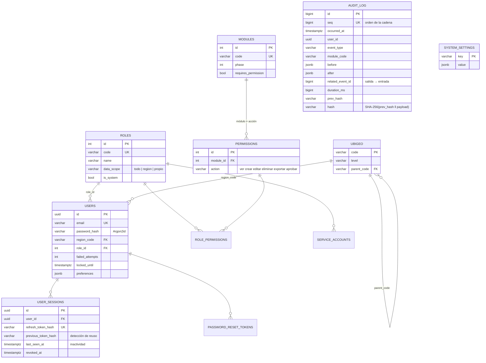
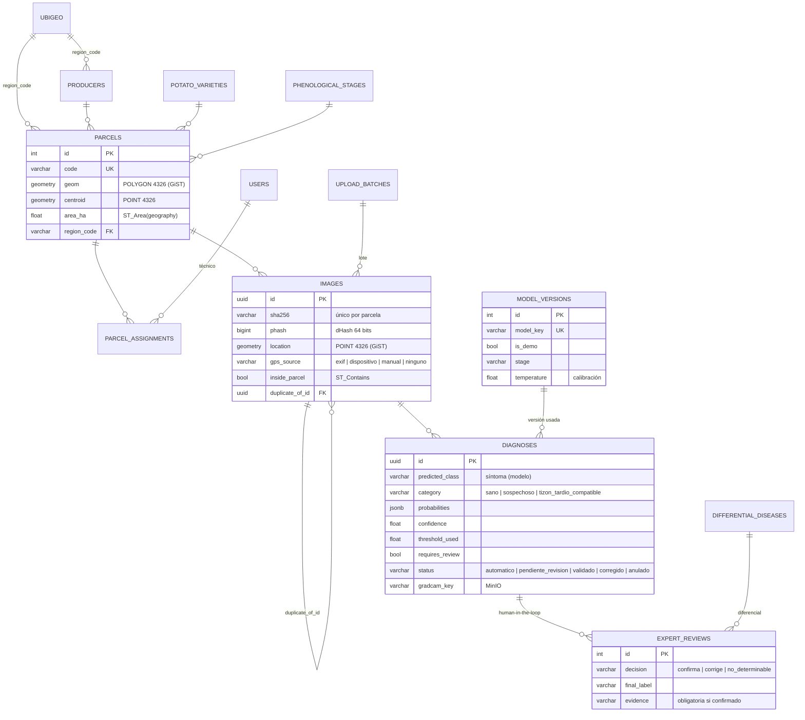
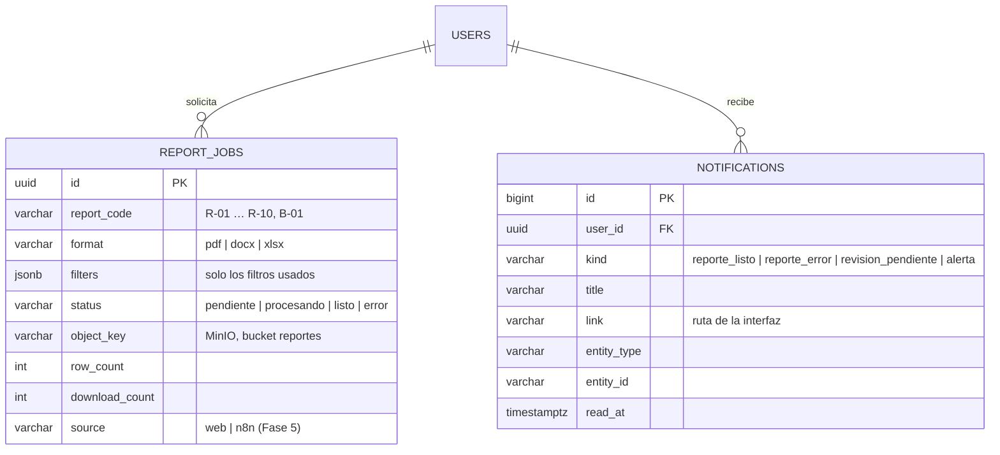
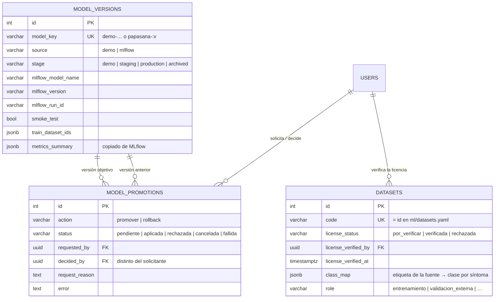

# Modelo de datos

Estado: **Fase 4**. Este documento crece con cada fase; el diseño completo previsto está en [fase0_plan.md §2](fase0_plan.md).

## Diagrama entidad-relación (implementado)

`auditoria.audit_log` no tiene claves foráneas a propósito: conserva `user_email` y `role_code` del momento del evento, de modo que el registro no depende de cambios posteriores en usuarios o roles.

## Esquemas

| Esquema | Tablas (Fase 1) |
|---|---|
| `seguridad` | `users`, `roles`, `modules`, `permissions`, `role_permissions`, `user_sessions`, `password_reset_tokens`, `service_accounts` |
| `auditoria` | `audit_log` + funciones `fn_audit_payload`, `fn_audit_chain`, `fn_audit_immutable` |
| `catalogo` | `ubigeo` (departamentos; provincias y distritos en la Fase 2) |
| `configuracion` | `system_settings` |

## Bitácora inmutable

1. **Trigger `trg_audit_chain` (BEFORE INSERT):** toma un `pg_advisory_xact_lock`, asigna `seq = último + 1`, `prev_hash = hash del último` y `hash = SHA-256(prev_hash ‖ JSON canónico del registro)`.
2. **Triggers `trg_audit_no_update_delete` y `trg_audit_no_truncate`:** lanzan una excepción ante UPDATE, DELETE o TRUNCATE, incluso para el propietario.
3. **Permisos:** el usuario de la aplicación (`papasana_app`) solo tiene `INSERT` y `SELECT` sobre la tabla.
4. **Verificación:** `GET /api/v1/audit/verify` recalcula la cadena completa e informa el primer registro alterado (`contenido_alterado`) o faltante (`cadena_rota`).

**Limitación conocida:** borrar los últimos registros de la cadena (truncar la cola) no rompe la cadena restante. Se mitiga en la Fase 5: WF-06 guardará cada día el último `seq` y `hash` fuera de la base de datos (anclaje externo), de modo que una cola eliminada se detecte al comparar.

## Fase 2: catálogos, campo y modelos

| Esquema | Tablas (Fase 2) |
|---|---|
| `catalogo` | `potato_varieties`, `phenological_stages`, `differential_diseases` |
| `campo` | `producers`, `parcels`, `parcel_assignments`, `upload_batches`, `images`, `diagnoses`, `expert_reviews` |
| `ml` | `model_versions` |

El usuario de la aplicación no tiene `DELETE` ni `TRUNCATE` sobre `campo.images`, `campo.diagnoses` ni `campo.expert_reviews` (D-38).

## Fase 3: reportes y notificaciones

| Esquema | Tablas (Fase 3) |
|---|---|
| `reportes` | `report_jobs` |
| `notificaciones` | `notifications` |

- El usuario de la aplicación no tiene `DELETE` sobre estas tablas: el historial de reportes y las notificaciones se conservan (D-43).
- Los datos de cada reporte se calculan al generarlo, a partir de las tablas de `campo`, `ml` y `auditoria`. No hay tablas de agregados.

## Fase 4: laboratorio de modelos y datasets

- El **Model Registry de MLflow** es la fuente de verdad: `model_versions` es una copia sincronizada, y la etapa `production` refleja el alias `production`.
- Los metadatos de MLflow viven en una base aparte (`mlflow`), con rol propio.
- El usuario de la aplicación no tiene `DELETE` sobre `ml.model_promotions` (historial de cuatro ojos).
